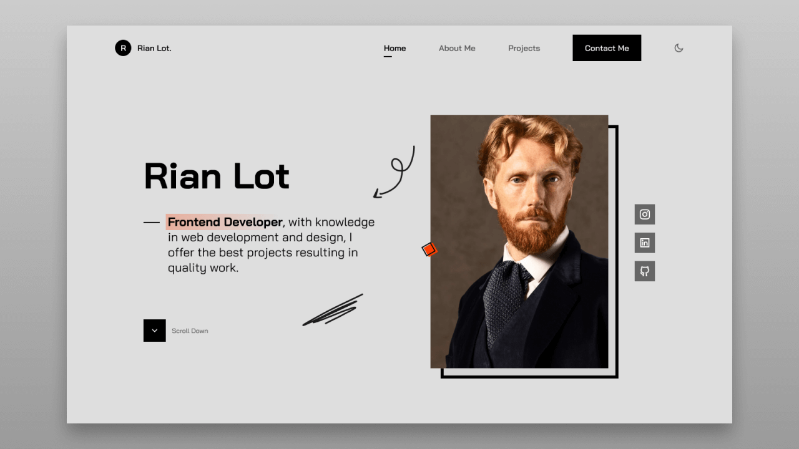

# Personal Website

A second version of my portfolio website, listing my front-end projects.

## Features

- About, skills and projects sections
- Links to the project repositories
- Responsive layout

## Run it

No build step. Open `index.html` in a browser, or serve the folder with any static server, for example `python -m http.server`.

## Credits

Layout based on a Bedimcode portfolio tutorial.

## Screenshots

